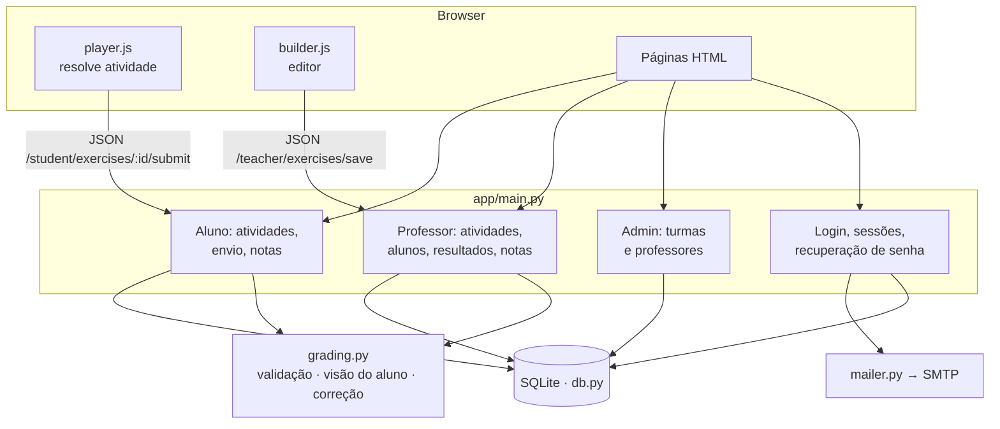
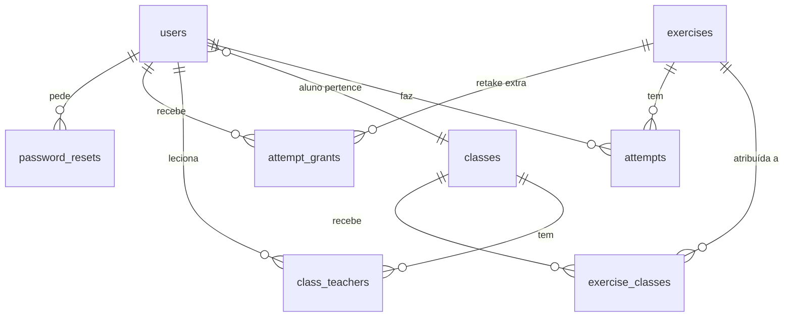

# Aplicações e arquitetura

## Aplicações e bibliotecas utilizadas

### No servidor
| Aplicação | Versão | Papel |
|---|---|---|
| Rocky Linux | 9.6 | sistema operacional da VM |
| Caddy | 2.11.4 | servidor web: HTTPS automático (Let's Encrypt), proxy reverso, gzip, HSTS |
| Python | 3.11.13 | runtime da aplicação |
| systemd | (do SO) | mantém a aplicação rodando e reinicia em falhas |
| SQLite | 3.34.1 | banco de dados (arquivo único, modo WAL) |
| cron | (do SO) | backup diário do banco |

### Bibliotecas Python ([requirements.txt](../requirements.txt))
| Pacote | Versão | Uso |
|---|---|---|
| FastAPI | 0.115.6 | framework web (rotas, validação de formulários/JSON) |
| Starlette | 0.41.3 | base do FastAPI; sessões assinadas, arquivos estáticos |
| uvicorn | 0.34.0 | servidor ASGI |
| Jinja2 | 3.1.5 | templates HTML renderizados no servidor |
| python-multipart | 0.0.20 | leitura de formulários |
| itsdangerous | 2.2.0 | assinatura do cookie de sessão |

Da biblioteca padrão: `sqlite3`, `hashlib` (PBKDF2), `smtplib` (e-mail), `zoneinfo`, `secrets`.

### No navegador
- **JavaScript puro** (sem framework, sem build): `static/player.js` (resolver atividades — arrastar, ligar
  com SVG, grupos) e `static/builder.js` (editor de atividades).
- **CSS próprio** (`static/style.css`) seguindo a identidade visual do site <https://lexwayenglish.com>:
  fundo `#efeae7`, verde‑petróleo `#062f34`/`#005555`, magenta `#e31c79`, turquesa `#64ccc9`,
  títulos em **DM Serif Text** e texto em **Nunito** (Google Fonts; o site usa a Runda, que é paga),
  cartões brancos com cantos de 20 px e botões com borda inferior "3D". Logo e favicon oficiais em `static/img/`.

### Serviços externos
| Serviço | Uso |
|---|---|
| Oracle Cloud (OCI) | hospedagem da VM |
| sslip.io | DNS que aponta o nome `64-181-168-113.sslip.io` para o IP |
| Let's Encrypt | certificado HTTPS gratuito |
| Gmail SMTP | envio dos e-mails de recuperação de senha |
| Google Fonts | fontes DM Serif Text e Nunito |
| GitHub | repositório do código |

## Arquitetura



- Páginas são renderizadas no servidor (Jinja2); só o editor e o player usam JSON.
- O servidor envia ao aluno uma **versão sem gabarito** de cada questão (`grading.student_item`): opções
  embaralhadas, sem marcação de resposta. A correção (`grading.grade_exercise`) roda no servidor e o
  resultado fica gravado na tentativa, junto com uma **cópia das questões** (`items_snapshot`), para que
  editar a atividade depois não altere correções antigas.

## Modelo de dados



| Tabela | Conteúdo |
|---|---|
| `users` | nome, usuário, e-mail, hash da senha, **role** (`admin`, `teacher`, `student`), turma (alunos), ativo |
| `classes` | turmas: nome, nível CEFR, descrição |
| `class_teachers` | quais professores têm acesso a cada turma |
| `exercises` | atividade: título, matéria, tópico, nível, questões (JSON), tentativas, política de nota, exibição de respostas, publicada, prazo, autor |
| `exercise_classes` | turmas que recebem a atividade (vazio = todas do nível) |
| `attempts` | tentativa do aluno: respostas, resultado detalhado, pontos, pendente de revisão, comentário do professor |
| `attempt_grants` | tentativas extras liberadas por aluno |
| `password_resets` | hash do token, validade e uso |

## Regras de nota
- Cada questão vale, por padrão, o número de itens (lacunas, pares, afirmações…) — texto livre vale 5.
  O professor pode definir outra pontuação.
- Acerto parcial é proporcional: 4 de 5 lacunas = 80% dos pontos da questão.
- Nota da tentativa = pontos obtidos ÷ pontos possíveis × 10.
- Nota final da atividade: **melhor**, **última** ou **média** das tentativas (configurável).
- Texto livre gera nota provisória (fração das palavras‑chave encontradas, metade se abaixo do mínimo de
  palavras) e a tentativa fica marcada ⏳ até o professor salvar a correção.
- Respostas certas aparecem: sempre, só quando acabarem as tentativas (padrão) ou nunca.

## Formato das questões (JSON salvo em `exercises.items`)

```jsonc
// Preencher lacunas — respostas entre colchetes, alternativas com |
{"type": "fill", "prompt": "Complete.", "text": "He [isn't|is not] at home."}

// Dropdown — opção correta marcada com *
{"type": "dropdown", "prompt": "Choose.", "text": "I [*am|is|are] from Brazil."}

// Múltipla escolha — índice da correta
{"type": "choice", "prompt": "Which is correct?", "options": ["She is a doctor?", "Is she a doctor?"], "correct": 1}

// Verdadeiro ou falso
{"type": "truefalse", "prompt": "Read and answer.", "statements": [{"text": "Anna is from Canada.", "answer": true}]}

// Colocar na ordem — partes na ordem correta + frases alternativas aceitas
{"type": "order", "prompt": "Put in order.", "tokens": ["Are", "you", "from", "Brazil?"], "alternatives": []}

// Ligar colunas
{"type": "match", "prompt": "Match.", "pairs": [{"left": "Are you a student?", "right": "Yes, I am."}]}

// Classificar em grupos
{"type": "group", "prompt": "Classify.", "categories": ["am", "is", "are"], "words": [{"text": "he", "category": "is"}]}

// Texto livre
{"type": "free", "prompt": "Write about you.", "model_answer": "My name is…", "keywords": ["I am"], "min_words": 15, "points": 5}
```

Campos comuns opcionais: `id` (gerado automaticamente), `image` (URL http/https) e `points`.

## Rotas principais

| Rota | Perfil | Função |
|---|---|---|
| `/login`, `/logout`, `/account` | todos | entrar, sair, e-mail e troca de senha |
| `/forgot`, `/reset/{token}` | público | recuperação de senha |
| `/admin/classes` | admin | CRUD de turmas e vínculo de professores |
| `/admin/teachers` | admin | CRUD de professores/administradores e acesso às turmas |
| `/teacher` | admin, professor | painel (pendências e envios recentes) |
| `/teacher/exercises…` | admin, professor | listar, criar, editar, duplicar, publicar, excluir, testar, resultados, retake extra |
| `/teacher/students…` | admin, professor | alunos e histórico |
| `/teacher/attempts/{id}` | admin, professor | ver tentativa e corrigir texto livre |
| `/teacher/gradebook[.csv]` | admin, professor | quadro de notas e exportação |
| `/users/{id}/reset-link` | admin, professor | gerar link de redefinição de senha |
| `/student…` | aluno | atividades, resolver, correção, notas |
